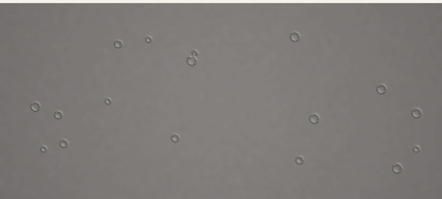
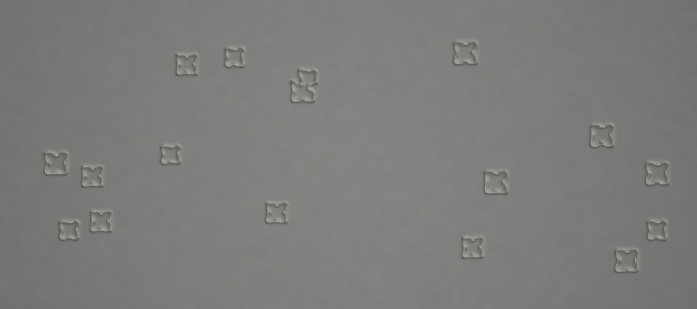
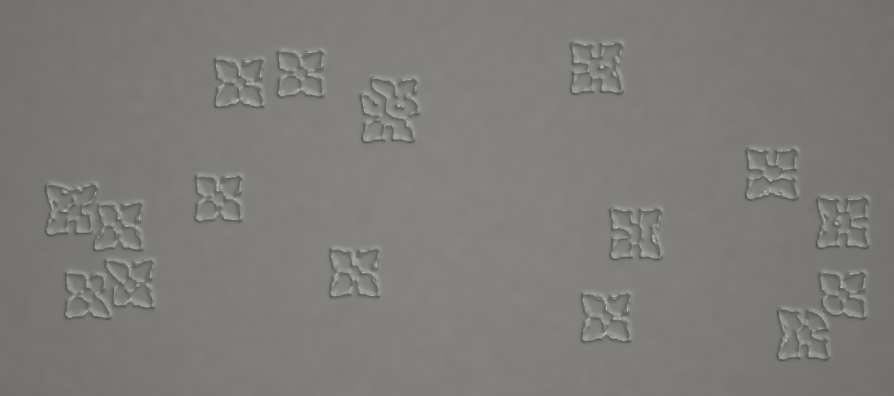
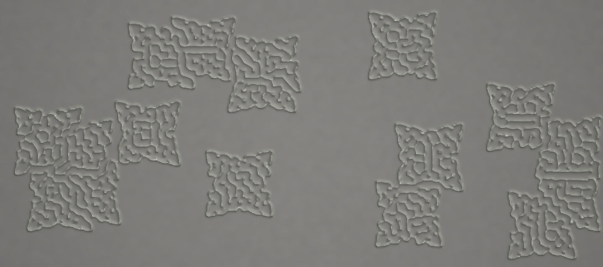
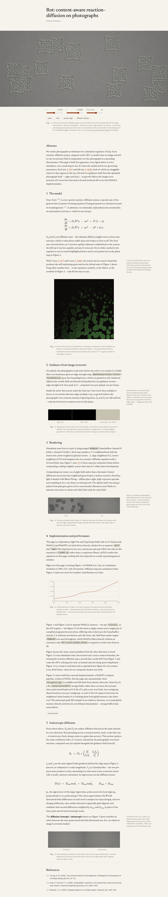

# Rot

**Live demo:** [LIVE_URL_HERE/?demo](LIVE_URL_HERE/?demo)

Figure 1, decaying over a minute of simulated time:

| t = 0s | t = 20s | t = 60s |
| :---: | :---: | :---: |
|  |  |  |

**Rot: content-aware reaction–diffusion on photographs.** A living research
paper (in the Distill.pub tradition) where every figure is a GPU simulation,
not a static illustration. A Gray–Scott reaction–diffusion system is seeded
onto a photograph and left to run; its activator field is composited over
the image as a spreading, lit discoloration that is guided by the
photograph's own edges and faces.

Byline: Muktanan Mohapatra.



## Concept

The page treats a photograph as a substrate for a simulated organism. Rather
than illustrate reaction–diffusion with diagrams, the document *is* the
simulation: the equations are typeset once, and every figure that depends on
them is computed live, in the browser, on the GPU — including a parameter
space explorer, a guidance-field breakdown, a flat-vs-lit rendering
comparison, and a biomass-over-time readout.

## The equations

Gray–Scott is a two-species reaction–diffusion system. A substrate
<em>u</em> is continually replenished and consumed by an autocatalytic
activator <em>v</em>, which in turn decays:

$$
\begin{aligned}
\frac{\partial u}{\partial t} &= D_u \nabla^2 u \;-\; u v^2 \;+\; F\,(1-u) \\
\frac{\partial v}{\partial t} &= D_v \nabla^2 v \;+\; u v^2 \;-\; (F + k)\,v
\end{aligned}
$$

$D_u$ and $D_v$ are diffusion rates (the substrate diffuses roughly twice as
fast as the activator — this asymmetry is what allows stable spots and
stripes to form at all). $F$, the feed rate, sets how quickly substrate is
replenished; $k$, the kill rate, sets how quickly activator is removed.
Different $(F, k)$ pairs produce qualitatively different patterns — spots,
stripes, self-replicating blobs, or nothing at all — which is what the
page's 8×8 phase-map figure is for.

The solver steps are nine-point weighted Laplacians, integrated with a
forward Euler step, run several times per animation frame before
compositing. It has two implementations — see "WebGPU and the benchmark"
below.

## Guidance from image structure

On upload, the photograph is read twice before the solver ever touches it:

- A **Sobel filter** over luminance gives a per-pixel edge-strength map.
- `@mediapipe/tasks-vision`'s **`FaceDetector`** gives face bounding boxes,
  painted as soft, feathered ellipses into a mask.

Both are blurred and packed into one guidance texture (edge strength in R,
face mask in G), computed once per upload, not per frame. Face detection
runs entirely client-side via a WebAssembly model fetched on first use; if
it fails to load, the face channel simply stays at zero and growth is
driven by edges alone — the feature degrades rather than breaking.

Inside the solver, this texture scales the feed rate $F$ per texel: faces
multiply it down, so rot reaches skin last; edges multiply it up, so growth
follows the photograph's own contours instead of ignoring them.

## Rendering

The activator field $v$ is treated as a height map. Central differences
across the four neighbouring texels give a surface normal, which is shaded
with Blinn-Phong under a fixed key light, plus a tight, high-exponent
specular term standing in for a wet sheen on fresh growth. The mould's
albedo runs along a palette from pale grey-green at low concentration
(bloom) to near-black as $v$ saturates (necrosis), so colour and relief
both track the same field.

## Anisotropic diffusion

$D_u$ and $D_v$ above are scalars — diffusion that moves the same amount in
every direction. A second mode replaces the scalar with a 2×2 tensor
oriented by the photograph's own local structure:

$$
S_\sigma = G_\sigma * \begin{pmatrix} I_x^2 & I_xI_y \\ I_xI_y & I_y^2 \end{pmatrix}
\qquad
D(x) = D_{\min}\,\mathbf{e}_1\mathbf{e}_1^{\!\top} + D_{\max}\,\mathbf{e}_2\mathbf{e}_2^{\!\top},
\quad D_{\min} < D_{\max}
$$

$S_\sigma$ is the Gaussian-smoothed structure tensor built from the same
signed Sobel gradients ($I_x$, $I_y$) behind the edge map. Its eigenvectors
set the diffusion tensor: $\mathbf{e}_1$ (the larger eigenvalue) points
across the local edge, $\mathbf{e}_2$ (perpendicular) points along it, so
substrate and activator diffuse more freely along a photograph's edges than
across them. The solver approximates this with directional finite
differences — two samples along $\mathbf{e}_1$ and two along $\mathbf{e}_2$,
bilinearly interpolated since neither is generally grid-aligned — rather
than a full tensor-weighted divergence. A `diffusion: isotropic/anisotropic`
toggle on the main figure switches the solver between the two live.

## WebGPU and the benchmark

Figure 1's solver has two implementations. The default is a WebGPU compute
pipeline (`src/gpu/step.wgsl`): state lives in a flat
`array<vec2<f32>>` storage buffer, and the isotropic nine-point stencil
loads an 8×8 tile of it — plus a one-texel halo — into **workgroup shared
memory** once per workgroup, so each output texel reuses its neighbours'
loads instead of re-fetching them from global memory nine times over. The
anisotropic path samples in an arbitrary direction, so it reads global
memory directly and does its own bilinear interpolation (storage buffers
have no hardware filtering).

When `navigator.gpu` isn't available, the page falls back automatically to
the WebGL2 implementation (`src/shaders/step.frag.glsl`): the same nine-point
stencil over ping-ponged `RGBA16F` framebuffers used throughout Phases 1–5.

A benchmark mode (the "run benchmark" button in §4 of the page) runs 24
timed steps — after a 5-step warm-up — at 512², 1024² and 2048² on each
backend and reports the median time per step:

| resolution | WebGL2 | WebGPU |
| ---------- | -----: | -----: |
| 512×512    |     —  |     —  |
| 1024×1024  |     —  |     —  |
| 2048×2048  |     —  |     —  |

<!-- TODO: replace with numbers from a real GPU — this sandbox's headless
Chromium has no WebGPU adapter, so the WebGPU column can't be measured here,
and the WebGL2 numbers it did produce were too fast for this environment's
timer resolution to be meaningful. Click "run benchmark" on the live page
for real numbers on your own hardware. -->

## Running locally

Requires Node.js 18+.

```bash
npm install
npm run dev
```

This starts a Vite dev server (default `http://localhost:5173`) with hot
module reload.

To produce a production build:

```bash
npm run build
npm run preview   # serve the built dist/ locally to sanity-check it
```

The build is a static site (`dist/`) — `vercel.json` is set up for a
zero-config static deploy on Vercel, but any static host works.

## Capturing the README media

`npm run capture` (`scripts/capture.ts`) builds the site, serves `dist/`,
and drives headless Chromium through `/?demo` to regenerate everything
under `docs/`: the screenshot, the three Figure 1 decay-sequence frames,
and the mp4/gif above. Requires Playwright's Chromium and `ffmpeg` on
`PATH`.
